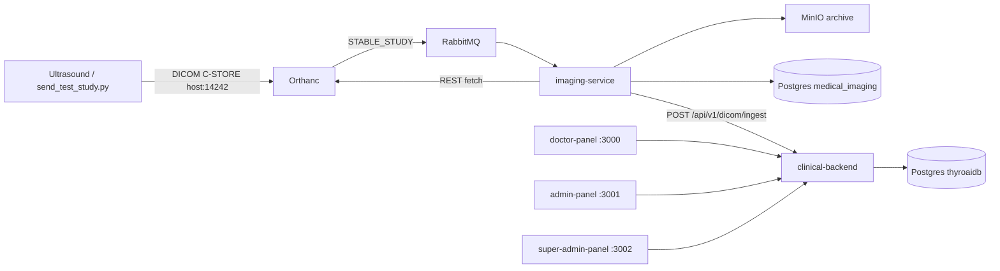

# ThyroAI Platform Architecture

## System diagram

## Services

### clinical-backend
Spring Boot clinical API (patients, examinations, annotations, JWT auth, Flyway).
Exposes `POST /api/v1/dicom/ingest` protected by `X-Ingest-Key` (`DICOM_INGEST_KEY`).

### imaging-service
Consumes Orthanc stable-study events from RabbitMQ, downloads instances from Orthanc,
stores DICOM + JPEG previews in MinIO, records metadata in `medical_imaging`, then
pushes a multipart study payload to clinical-backend.

### orthanc
DICOM SCP. Config is rendered at container start from `orthanc.json.template` via
`envsubst` (credentials and AE title come from env). A Python plugin publishes
durable JSON messages to RabbitMQ when a study becomes stable.

### Frontends
React/Vite apps served by nginx. `/api/` and `/images/` are reverse-proxied to
`clinical-backend` on the Compose network.

### Shared infrastructure
| Component | Role |
|-----------|------|
| Postgres 16 | Shared instance; DBs `thyroaidb` + `medical_imaging` |
| RabbitMQ | Orthanc → imaging-service events |
| MinIO | S3-compatible long-term DICOM/preview storage |

## Trust boundaries

- Modality AE titles must be registered in Orthanc `DicomModalities` (`US_SIM` for the test tool).
- Imaging → clinical ingest uses a shared secret header, not user JWTs.
- Panel nginx proxies keep browser traffic same-origin for local Compose.

## Failure handling

- Transient Orthanc / MinIO / clinical 5xx → imaging-service nacks and requeues.
- Permanent clinical 4xx / bad config → message dropped (nack without requeue).
- MinIO bucket is created by `minio-init` once MinIO is healthy.
